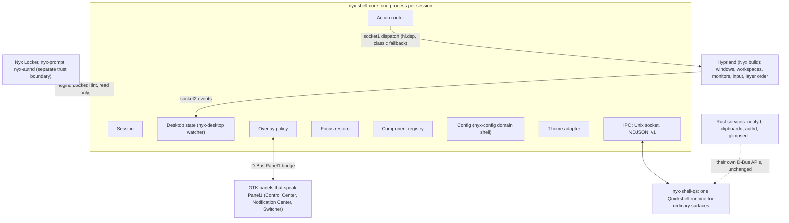
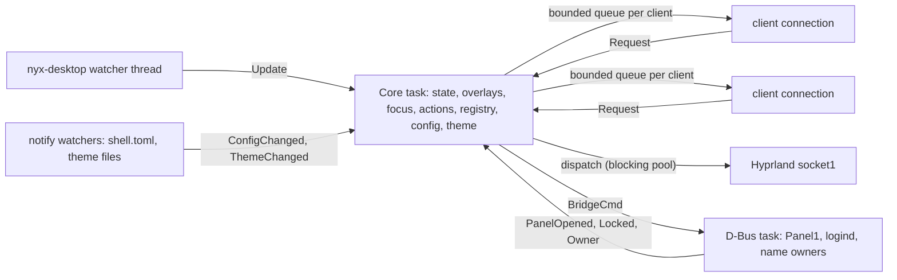

# Nyx Shell Core: architecture

Handoff 01. How the shell's coordination layer is split, what runs where, and why.
The protocol is in [PROTOCOL.md](PROTOCOL.md), the trust boundaries in
[SECURITY.md](SECURITY.md), what was found before building in [AUDIT.md](AUDIT.md).

## Layers



1. **Hyprland** owns compositor state. Shell Core never keeps its own idea of where a
   window is: its state is Hyprland's, normalized, with a generation number.
2. **Shell Core** (`apps/shell-core`, library `crates/nyx-shell-core`) coordinates:
   state, overlays, focus, actions, components, configuration, theme events. It hosts no
   UI, no inference, no media, no app logic.
3. **Presentation**: Quickshell surfaces use the shared `Nyx.Shell` QML module
   (`qml/Nyx/Shell`). GTK4 apps stay GTK4.
4. **Services** keep their backends and their own APIs. Shell Core routes to them; it
   doesn't absorb them.

## Inside Shell Core

One tokio runtime. All shared state lives in a single `Core` value owned by one task;
everything else talks to it with messages, so there are no locks around state and every
rule can be tested by feeding `Core` messages directly.



| Module | File | Responsibility |
| --- | --- | --- |
| Session | `session.rs` | Lifecycle state (starting, ready, degraded, stopping), session id, readiness notification, diagnostics |
| Desktop state | `state.rs` | Normalizes `nyx_desktop::Desktop` into the wire schema, assigns generations, computes deltas |
| Hyprland adapter | `compositor.rs` | The `nyx-desktop` watcher (windows, workspaces, monitors with refresh rate, mapped layer surfaces), dispatching (disabled in read-only mode) |
| Overlay policy | `overlay.rs` | Registry of overlay policies, show/hide/toggle, exclusive groups, fullscreen and lock rules, placement |
| Focus | `focus.rs` | Remembers the focused window when a transient overlay opens; gives focus back only when safe |
| Actions | `actions.rs` | Fixed action table, routing, availability, shortcut file generation and duplicate checks |
| Components | `registry.rs` | Manifests, state machine, dependencies, health |
| Config | `config.rs` | Typed `shell` domain over `nyx-config`, validation, reset, change events |
| Theme | `theme.rs` | Watches theme inputs once, publishes a generation and palette |
| IPC | `ipc.rs`, `server.rs`, `peer.rs` | Framing, peer identity and capabilities, per-client queues |
| D-Bus | `bridge.rs` | `Panel1` signals and calls, bus-name ownership, logind `LockedHint` |

### Desktop state and synchronization

- The `nyx-desktop` watcher subscribes to socket2 first and snapshots second, so nothing
  is missed between them, batches events that need fresh data, and reconnects with a
  fresh snapshot when Hyprland restarts.
- Each update becomes a new normalized `DesktopState` with `generation + 1`. Clients get
  a delta (`base` generation, upserts and removals per collection, the active
  monitor/workspace/window) instead of the whole state.
- A client applies a delta only when `base` equals the generation it holds; otherwise
  it asks for a snapshot again. A subscription reply always carries the current
  snapshot, so a client never processes live updates before it has a consistent base.
- Every event to a client carries a per-connection `seq`. A client that sees a gap
  resynchronizes.
- Each client has a bounded queue (`ipc.max_queue`, default 256). If it fills, the
  client's pending events are dropped and it is sent one `Resync` naming the topics to
  fetch again, instead of being disconnected or slowing everyone down.
- Hyprland's event socket says nothing when a monitor's mode, scale or position changes
  at runtime (only the Lua event `monitor.layout_changed` fires). NyxOS's Hyprland config
  turns that Lua event into a socket event:

  ```lua
  hl.on("monitor.layout_changed", function() hl.dispatch(hl.dsp.event("nyx-monitors")) end)
  ```

  Hyprland posts it as `custom>>nyx-monitors`, and `nyx-desktop` reads the monitors
  again when it sees it (nyx-core `a93881d`, which also brought refresh rates and mapped
  layer surfaces into the model). No compositor change, only supported configuration
  and IPC.

### Overlays

The registry is declarative: built-in entries for the GTK panels, NyxOS defaults from
`shell.toml`, and entries that clients register. Each entry has:

| Field | Values | Meaning |
| --- | --- | --- |
| `category` | `passive`, `transient`, `persistent`, `presentation`, `secure-external` | What kind of surface it is |
| `group` | a name, or none | Showing one overlay hides the others in its group |
| `keyboard` | `none`, `on-demand`, `exclusive` | Requested keyboard mode; `passive` and `presentation` must be `none` |
| `fullscreen` | `show`, `hide`, `block` | Over a fullscreen window on its monitor: draw anyway, hide until it's gone, or refuse to open |
| `placement` | `active`, `pointer`, `all`, `monitor:NAME` | Where it opens |
| `restore_focus` | bool | Give focus back to the previous window on close |

Rules (`overlay.rs`):

- Shell Core is the single source of truth for whether an overlay is shown. A surface
  shows when its state says `visible`; Escape or a click outside asks Shell Core to hide.
  Each change has a `revision`, so a surface ignores stale instructions after rapid
  open/close.
- Showing an overlay hides the others in its group. Passive overlays never hide
  anything and never take the keyboard.
- While the session is locked every overlay is hidden and show requests fail with
  `locked`. `secure-external` entries (the lock screen) are listed for diagnostics only
  and can't be driven over IPC.
- When an overlay's owner disconnects, its overlays are removed, so no surface is left
  orphaned.
- When an overlay's monitor goes away it moves to the active monitor.
- **Pinned overlays** (`PinOverlay`, persistent only, such as Glimpse's pinned panels)
  stay until unpinned and aren't hidden by their group. Shell Core places them: down
  an edge of their monitor's usable area (`[pins]`: right or left) in pin order, laid
  out again when the monitor's size or reserved area changes. One moved by hand
  (`MovePinnedOverlay`) stays where it was put, inside the usable area, and the stack
  closes up without it. They take the keyboard only on demand
  (clicked), restore no focus, and follow the fullscreen and lock rules.
- **`Panel1` bridge:** Shell Core listens for `Opened(s id)`. A GTK panel opening hides
  Shell Core overlays in its group. A Shell Core overlay opening in group `panels` emits
  `Opened("nyx-shell:ID")`, which the GTK panels already obey. Whether a panel is open
  follows its layer surface (`nyx-control-center`, `nyx-notification-center`,
  `nyx-switcher`, `nyx-overview`) as Hyprland maps and unmaps it, so a panel closed with
  Escape or a click outside is seen at once; bus-name ownership tells whether they run.
  The panels keep working unchanged whether or not Shell Core runs.

### Focus

When a transient overlay with `restore_focus` opens, Shell Core remembers the focused
window. When the last such overlay closes it focuses that window again only if all of
these hold: it still exists, it is on a workspace shown on some monitor, the session
isn't locked, no other window has been focused since (the user's choice wins), and no
restore happened in the last 500 ms. That last rule makes focus loops impossible. In
read-only mode nothing is dispatched.

Measured in the NyxOS VM: a layer surface taking the keyboard doesn't change Hyprland's
active window, and while an exclusive surface holds the keyboard Hyprland refuses focus
changes. When it closes, Hyprland gives the keyboard back to the active window itself,
so Shell Core dispatches nothing. Restoration acts only when the active window was lost
meanwhile (with on-demand overlays a click can move it).

### Actions and shortcuts

Actions have fixed ids. Built-in routes:

| Action | Route | Available when |
| --- | --- | --- |
| `shell.control-center.toggle` | `Panel1.Toggle` on `io.github.design_nexus.nyx.ControlCenter` | the bus name has an owner |
| `shell.notification-center.toggle` | `Panel1.Toggle` on `io.github.design_nexus.nyx.NotificationCenter` | the bus name has an owner |
| `shell.switcher.overview` | `overview <µs>` on the switcher socket | the socket exists |
| `shell.glimpse.toggle` | runs `nyx-glimpse --toggle` (fixed argv) | `nyx-glimpse` is on `PATH` |
| `shell.overlay.toggle:ID` | the overlay registry | the overlay is registered |
| anything a component declares | an `ActionInvoked` event to that component | the component is ready |

There is no operation that runs a command given by a client.

Shortcuts are opt-in: `[shortcuts]` in `shell.toml` maps an action to keys. `nyx-shellctl
shortcuts --check` lists conflicts with `hyprctl -j binds`; `--apply` writes the owned
file `~/.config/hypr/nyx-shell.lua` (each bind runs `nyx-shellctl invoke ACTION`, with a
description starting `Nyx Shell:` so ownership is recognizable), reloads Hyprland, checks
`configerrors` and restores the previous file on any error. NyxOS's `hyprland.lua` loads
the file when it exists. NyxOS ships no shortcuts in `shell.toml`, so the keys its
`hyprland.nix` already binds stay owned there: no duplicate ownership.

### Components

A component registers a manifest (id, kind, process, required and optional
dependencies, actions, overlays, restart policy, capabilities) and moves through
`registered → starting → ready ⇄ degraded → stopped | failed`. A component whose
required dependency isn't ready is reported `degraded`. A connection that drops
without reporting `stopped` marks its components `failed`. One live connection per id:
a second registration of a running id is refused (`conflict`), which stops duplicate
singletons. The GTK panels are built-in components whose state follows their bus names.

systemd restarts processes; the registry reports and doesn't restart anything itself.

### Configuration

`nyx-config` domain `shell`: `/etc/nyxos/defaults/shell.toml` < `/etc/nyxos/overrides/shell.toml`
< `~/.config/nyx/shell.toml`. The typed schema is `ShellConfig` in `config.rs`. Invalid
sections fall back to their defaults one at a time and are reported in diagnostics.
Updates go to the user layer through `nyx-config` (atomic write); reset removes the
user's key so the layer below shows through. The folders are watched with inotify.

### Theme

Theme Engine 2.0 (`nyx-themed`, `io.github.design_nexus.nyx.Theme1`) resolves the
system theme once and writes an immutable snapshot,
`$XDG_RUNTIME_DIR/nyx/theme/system.json`, then announces `ThemeChanged`. Shell Core
listens for that signal (by interface and path, as the engine's contract asks) and
watches the snapshot's folder, reads the snapshot (format 1) and publishes
`ThemeChanged` to clients with its own generation, the engine's generation, the theme's
id, name, light flag and colours by their established names. It parses no theme files.

Without the engine (Omarchy today), it watches `~/.config/nyx/theme.toml`,
`~/.config/nyx/themes/` and Omarchy's current theme folder instead; the opt-in
`palette` feature then resolves colours with `nyx-theme`, which links GTK. Either way
the generation moves only when the inputs' contents change.

## Process boundaries

| Process | Runs | Why separate |
| --- | --- | --- |
| `nyx-shell-core` | the coordinator | Must survive any UI crash; tiny |
| `nyx-shell-qs` | ordinary Quickshell surfaces (Handoff 03 moves them here) | One QML engine for closely related surfaces; a crash takes all of them, and only them |
| GTK panels, dock, bar, widgets | as today | Unchanged until Handoff 03 |
| `nyx-notifyd`, clipboard, Glimpse daemons, Assistant | as today | Own lifecycles and backends |
| Nyx Locker, nyx-prompt, nyx-authd, keyd | as today | Security boundary; never inside an ordinary shell runtime |

A component goes in its own Quickshell process instead of the shared one when it needs a
different security context, does heavy or failure-prone work, has its own lifecycle, or
must be isolated from the others' crashes (Assistant HUD, anything authentication).

## Startup, shutdown, recovery

1. uwsm starts `graphical-session.target` with Hyprland.
2. `nyx-shell-core.service` (`Type=notify`) starts: takes `$XDG_RUNTIME_DIR/nyx-shell/core.lock`,
   replaces a stale socket or exits quietly if another instance answers, binds the
   socket, starts the watcher, reads config and theme, and sends `READY=1` once the first
   compositor snapshot arrived or after 2 s, whichever is first. Optional pieces (D-Bus
   bridge, logind) start in the background and never block readiness.
3. `nyx-shell-qs.service` (`Wants=`/`After=` the core, not bound to it) starts Quickshell;
   its components register and report ready.
4. On SIGTERM the core marks the session `stopping`, tells clients (`Shutdown`), removes
   its socket and exits.

| Failure | Behaviour |
| --- | --- |
| Shell Core restarts | Clients reconnect with backoff and take fresh snapshots; overlays they own are registered again |
| Quickshell runtime restarts | Its components go `failed`, then `ready` again after re-registering |
| Hyprland IPC interrupted | Session `degraded`, state `connected: false` (last known state kept), resnapshot on reconnect |
| Monitor removed | State delta; overlays on it move to the active monitor |
| Component crash | Its overlays are removed, its state `failed`; dependents `degraded`; nothing else changes |
| Optional backend missing | Its actions are `available: false`; nothing waits on it |
| Malformed configuration | Defaults for the broken section, error listed in diagnostics |
| Theme update during an overlay | A theme event; surfaces restyle in place |

systemd restarts with `Restart=on-failure`, `RestartSec=1`, and `StartLimitBurst=5` in
`StartLimitIntervalSec=60`, so a crash loop stops instead of spinning. The compositor is
never restarted because of a shell failure.

## Platforms

One implementation. Paths come from XDG variables and `nyx-config`; nothing names
Omarchy except the theme adapter's Follow Omarchy input, which is the existing
`nyx-theme` behaviour. Development and read-only validation happen on Omarchy; NyxOS is
the supported platform and gets the package and units through nyx-packages.
