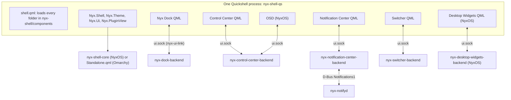

# Handoff 03: moving shell components to Quickshell

What each component does today, what its QML replacement must keep, how the work is
split between a Rust backend and QML, and the measurements the replacements are held to.
Audited 2026-11-08 from the checkouts in `~/Projects` (read-only), with the running GTK
services measured from `/proc`.

Scope of this pass: stages A to G. Glimpse and the Assistant Aura (stage H) wait for
Handoff 05; the lock screen and greeter feasibility (stage I) and NyxOS integration and
removal of the GTK code (stage J) come later. Nyx Bar stays GTK.

## Where each component runs

| Component | Laptop (Omarchy) | NyxOS |
| --- | --- | --- |
| Dock | QML, replacing the installed GTK dock after its parity check | QML |
| Control Center | QML, replacing the installed GTK panel after its parity check | QML |
| Notification Center (panel and pop-ups) | QML; `nyx-notifyd` unchanged | QML; `nyx-notifyd` unchanged |
| Switcher (Quick Switch, Overview) | QML, replacing the installed GTK switcher after its parity check | QML |
| Desktop Widgets | not installed | QML |
| OSDs | not installed (Omarchy's own) | QML, new |
| Nyx Shell Core | not installed | `nyx-shell-core` |

On the laptop nothing of Nyx Shell Core is installed: the components carry pinned copies
of the QML modules and run them in one shared Quickshell process, with `Nyx.Shell` in its
standalone mode. NyxOS runs the same QML in `nyx-shell-qs` against Shell Core.

## Architecture

- **Backends** are each component's existing Rust code without GTK: settings, services,
  launching, the plugin host, D-Bus names. Each is its own binary without GTK
  (`nyx-dock-backend`, …) and runs as its own user service, so a Quickshell crash takes
  down drawing, never a service. They speak `nyx-ui-link`
  (nyx-core): one Unix socket at `$XDG_RUNTIME_DIR/<app>/ui.sock`, Shell Core's NDJSON
  framing, topics sent as a snapshot then merge patches, `Resync` for a client that
  falls behind.
- **QML** draws and takes input: `BackendClient` (Nyx.Shell) keeps each topic current;
  requests go back as operations.
- **Desktop state in QML** comes only from `Nyx.Shell`: Shell Core on NyxOS, or
  `Standalone.qml` on Omarchy, which reads Hyprland's sockets itself (Quickshell 0.3.2's
  own Hyprland module can't parse Hyprland 0.56's monitors and workspaces) and applies
  Shell Core's overlay rules in-process. `NYX_SHELL_MODE` = `core`, `standalone`, or
  `auto` (try Shell Core once).
- **Desktop state in backends**: the Dock's hiding, swipe following and window fitting,
  and the Switcher's MRU model, stay in Rust on `nyx-desktop`'s watcher, unchanged. Shell
  Core's wire state has no window geometry, which the Dock's overlap test needs; moving
  those backends onto Shell Core is an open item for stage J. QML surfaces never open
  Hyprland's sockets in Shell Core mode.
- **Panels keep `Panel1`.** The Control Center, Notification Center and Switcher backends
  own the same bus names and serve `io.github.design_nexus.nyx.Panel1` exactly as the GTK
  panels did, and the QML surfaces use the same layer namespaces. So keybinds, the bar's
  plugins, Shell Core's Panel1 bridge and a GTK panel switched back with `--ui gtk` all
  keep working, and mutual exclusion holds across GTK and QML panels. Replacing `Panel1`
  with Shell Core overlay registration is stage J.
- **Theme**: every QML surface uses `Nyx.Theme` (the engine's snapshot). On Omarchy no
  theme service runs, and the GTK shell components were what kept the snapshot current
  (`use_shell_scope`); the Dock and Control Center backends take over that duty with
  `nyx-theme-core`, without GTK.
- **Switch**: `nyx-<app> --ui qml|gtk` swaps the units and the component's link in
  `~/.local/share/nyx-shell/components`; the runtime loads and unloads it live. The GTK
  code stays until stage J.

## Shared pieces built for this

| Piece | Where | What |
| --- | --- | --- |
| `nyx-ui-link` | nyx-core `crates/nyx-ui-link` | Backend socket: same-user peers, topics with merge patches, events, `call()` for command lines |
| `BackendClient` | `qml/Nyx/Shell` | The QML side of `nyx-ui-link` |
| Standalone mode | `qml/Nyx/Shell/Standalone.qml` | Desktop state, overlays, components, window actions without Shell Core |
| Host | `qml/shell.qml` | Loads component folders from `NYX_SHELL_COMPONENT_PATH` or `…/nyx-shell/components`, live |
| `Nyx.Ui` | nyx-design `qml/Nyx/Ui` | Style (GTK shell colour names on Theme Engine tokens), Label, Icon, IconButton, Button, Toggle, Slider, ListRow, SearchField, Segmented, SplitTile, Card, Surface, Menu, Tip, Badge, Spinner, ProgressBar, Separator, StateView, FocusRing |
| `Nyx.PluginView` | nyx-design `qml/Nyx/PluginView` | Plugin view trees (nyx-plugin-protocol `Node`) drawn in QML, patches by node id |

### Plugin views: what QML can't do as GTK did (needs approval to change)

- **Plugin `style.css`** (scoped GTK CSS) isn't applied. Views keep their node colours,
  sizes, classes (`accent`, `success`, `warning`, `danger`, `dim`, `active`, `urgent`),
  hover and pressed sets.
- **Pango markup** is shown through Qt's StyledText: `<b> <i> <u> <s> <small> <big>
    <tt>` and spans with `size`, `weight`, `style` and `foreground`. Other span
  attributes are dropped, keeping the text.
- **`frame` nodes** (memfd buffers over SCM_RIGHTS) show nothing: QML can't take the
  file descriptors. A backend relay (copying frames into an image provider) is possible
  but costs a copy per frame; no shipped plugin uses frames.
- SVG drawings use Qt SVG instead of librsvg (no filters, no CSS in SVG).

## Baselines (GTK, measured 2026-11-08 on the laptop, 30 s from `/proc`)

| Process | RSS | Private | Swapped | CPU | Wakeups/s |
| --- | --- | --- | --- | --- | --- |
| nyx-dock | 60.3 MiB | 37.3 MiB | 59.2 MiB | 1.63 % | 58.5 |
| nyx-control-center (hidden) | 9.9 MiB | 1.4 MiB | 8.1 MiB | 0.00 % | 1.3 |
| nyx-notification-center (hidden) | 11.0 MiB | 2.5 MiB | 6.3 MiB | 0.07 % | 1.3 |
| nyx-notifyd | 4.7 MiB | 2.4 MiB | 2.1 MiB | 0.03 % | 0 |
| nyx-switcher | 53.5 MiB | 41.2 MiB | 26.1 MiB | 0.33 % | 32.0 |

Together the four UI processes are about 82 MiB private (about 182 MiB private plus
swapped). Handoff 01 measured Quickshell's own floor at 56 MiB private
([PERFORMANCE.md](PERFORMANCE.md)). Latency baselines from Handoff 01's work and the
components' own debug output: Alt+Tab key to the switcher's request about 1 ms
(`nyx-switcher-send` to the socket), panel show to layer surface about 5 ms.

## Component inventories and parity matrices

Status values: **kept** (same behaviour, same code), **moved** (same behaviour, Rust
unchanged, now behind the backend), **redrawn** (QML draws what GTK drew), **open** (not
yet in the QML version; the GTK default stays until it is), **changed** (deliberately
different, with the reason).

### Nyx Dock

Today: Rust, GTK4, gtk4-layer-shell (`apps/dock`, 5.6k lines of UI), `nyx-dock-core`
(settings, items, hiding, swipe, card sources; no GTK), a Hyprland plugin for swipe
progress. One surface per monitor (`nyx-dock`), an edge strip (`nyx-dock-edge`), the
window-controls pill (`nyx-window-controls`). Settings `~/.config/nyx/dock.toml`.

| Behaviour | Where it lives after | Status |
| --- | --- | --- |
| Items: Apps button, pins, running apps in start order per output, separator, folders, Trash | backend `items::compose` | moved |
| Window matching (`key_for`), alias pins (Omarchy's Browser entry), `class:` items | backend | moved |
| Dots (1–2), focused accent bar, urgent (window or badge) | QML from item state | redrawn |
| Click: launch / next window / front window; minimized restored; middle click new window | backend `launch`, `items::pick_window`, `next_window` | moved |
| Launch argv (`uwsm-app -- gtk-launch`, `omarchy-launch-tui`, GIO fallback) | backend `launch.rs` | kept |
| Hover previews (delay, cards with thumbnail, close, workspace badge) | QML; pictures from the backend's `nyx-desktop` capture | redrawn |
| App card: header, MPRIS panel, Calendar/Files/Browser/Music/Recent lists, windows, actions, footer | backend gathers (`card.rs` sources, MPRIS), QML draws | redrawn |
| Drag to reorder pins, drop outside to unpin, across monitors, from the Apps panel | QML drags, backend `pin` | redrawn |
| Files onto apps / folders / Trash, folders onto the bar | QML drops, backend acts (GIO) | redrawn |
| Folder stacks: looks, counts, fan/grid/list/files, sort, menu, thumbnails and generation | backend lists and thumbnails, QML draws | redrawn |
| Trash tile, count, open, empty (armed) | backend, QML | redrawn |
| Apps panel: grid, search, launch, pin, uninstall via Nyx Store | backend list, QML | redrawn |
| Dock menu: size, position, hide, switches, add folder, Dock settings | QML, backend saves | redrawn |
| Badges (Unity LauncherEntry) | backend `badges.rs` | moved |
| Smart / Always / Never hiding, settle-and-reverify, edge strip, stale holds | backend decides (`hide.rs`, the state machine), QML reports hover/holds and bar size | moved |
| Slide (ease in 180 ms, out 200 ms, fade over the last 40 %) | QML animation | redrawn |
| Swipe following (plugin events, `resolve_loop`, `LEAD`) | backend `swipe` | moved |
| Never keeps space (exclusive zone), moves floating windows off the dock | backend computes, QML sets the zone | moved |
| Per-monitor docks by stable id, headless off unless a section enables it | backend effective settings per monitor | moved |
| Window-controls pill | QML surface, backend follows the active window | redrawn |
| Theme snapshot for Quickshell parts | backend (`nyx-theme-core`) | changed (was the GTK theme adapter) |
| Test hooks `NYX_DOCK_TEST_*`, `--only`, `NYX_DOCK_DEBUG` | backend and QML read the same variables | kept |

### Control Center

Today: Rust, GTK4 (`apps/control-center`, 6k lines), `nyx-providers` (15 providers, glib
and gio, no GTK), `nyx-widgets` (layout), plugin tiles through `nyx-plugin-host` and
`nyx-plugin-view`. Bus name `io.github.design_nexus.nyx.ControlCenter`, `Panel1` id
`control-center`, `ControlCenterPlugins1`. Layout `~/.config/nyx/control-center.toml`
(version 3, migrations kept).

| Behaviour | Where it lives after | Status |
| --- | --- | --- |
| 18 tile kinds, sizes, 4-column grid of 48 px rows, first-fit packing | backend layout (`nyx-widgets`), QML grid | redrawn |
| Split tiles (main toggles, arrow opens details), 1×1 plain toggles | QML `SplitTile` | redrawn |
| Detail views: Wi-Fi, Bluetooth, VPN, Tailscale, Screens, Battery, plugin details | backend providers, QML views | redrawn |
| Sound and brightness sliders, outputs popover, apps' volumes, microphone | backend `audio`, `brightness`, `display` | moved |
| Media, Up next, Home, Power, Backup tiles | backend providers | moved |
| Providers run only while their tile is on screen | QML subscribes per visible tile; backend starts/stops `Live` | kept |
| Pages: swipe, horizontal scroll, dots, remember page | QML | redrawn |
| Edit mode: remove, resize, drag reorder, drag to a page dot, add page, tray, restore (armed) | QML, backend `layout` | redrawn |
| Panel: top-right card 400 px wide, focused monitor, catcher, Escape, `Panel1` | backend owns the bus name and `Panel1`; QML surfaces with the same namespaces | kept |
| `--toggle [target]`, `--show`, `--hide` | command line → backend (`nyx-ui-link` call) | kept |
| Plugin tiles: lifecycle (run while shown, stop 2 min after), views, patches, events, `ControlCenterPlugins1` | backend hosts plugins, QML `PluginView` | redrawn (see plugin view gaps) |
| Passwords to `nmcli` on stdin | backend | kept |
| Clipboard copy (Tailscale) | QML through `wl-copy` | changed (no GDK clipboard) |

### Notification Center

Today: `nyx-notifyd` (zbus, no GTK, SQLite store, `org.freedesktop.Notifications` in Nyx
mode) and the GTK panel and pop-ups (2.2k lines). Panel `Panel1` id
`notification-center`, bus name `io.github.design_nexus.nyx.NotificationCenter`.

| Behaviour | Where it lives after | Status |
| --- | --- | --- |
| Storage, retention, pins, gone markers, code masking, privacy exclusions | `nyx-notifyd` | kept (unchanged) |
| Inbox: pinned strip (2), grouping by app with expand/collapse, unread dots, empty state | QML from `Inbox`/`Pinned` | redrawn |
| Pinned view, History (search, app filter, days filter, day headings, highlights) | QML, `History` query through the bridge | redrawn |
| Settings view: DND, schedule, retention, delete history (confirm), codes, pop-up text, per-app pop-ups and history | QML, `SetSettings` | redrawn |
| Card: icon chain, app name, time, title, body (3 lines), codes to Nyx Clipboard, app and Omarchy actions, pin, dismiss/delete, click to activate | QML, bridge calls | redrawn |
| Pop-ups: top right, newest on top, 4 at most, timeouts from notifyd, hover pause, replaced in place, none while the panel is open | QML passive surface | redrawn |
| Mark all read on close, Clear all spares pins | bridge → notifyd | kept |
| Message bodies never logged; no QML persistence | QML holds notes in memory only while shown | kept |
| `--toggle [view]`, `--show`, `--hide`, `--use-nyx-popups`, `--use-omarchy-popups` | command line | kept |

### Switcher

Today: GTK (`apps/switcher`, 2.2k lines), `nyx-switcher-core` (model, session, overview,
binds, config; no GTK), `nyx-switcher-send` (std only). Socket
`$XDG_RUNTIME_DIR/nyx-switcher.sock`, `Panel1` id `switcher`.

| Behaviour | Where it lives after | Status |
| --- | --- | --- |
| `nyx-switcher-send` and the socket protocol, fallback to Hyprland's cycling | unchanged binary; backend listens | kept |
| Modes windows / apps / same-app, scopes, agent workspaces, groups collapse | backend `nyx-switcher-core` | moved |
| Session: first selection, stepping, expand/collapse, live refresh | backend `Session` | moved |
| Modifier release commits (held mask from the binds) | QML key release on an exclusive surface | redrawn |
| Reveal delay (`show_delay_ms`), animation | QML | redrawn |
| Keys: Esc, Enter/Space, Tab, `, arrows, Home/End, Delete closes, typing searches | QML → backend operations | redrawn |
| Tiles: app, window, thumbnail sizes, columns, captions, place | QML; thumbnails from the backend's capture | redrawn |
| Overview: profiles menu, search, workspace cards, per-window actions and Ctrl keys, click outside closes | QML, backend actions | redrawn |
| `--integrate` (owned binds with rollback), `--check-keys` | unchanged | kept |

### Desktop Widgets (NyxOS)

Today: GTK (`apps/desktop-widgets`, 2.5k lines), `nyx-desktop-widgets-core` (layout,
geometry; no GTK), plugin host. `DesktopWidgets1`. Layout
`~/.config/nyx/desktop-widgets.toml` (comments kept through `toml_edit`).

| Behaviour | Where it lives after | Status |
| --- | --- | --- |
| One bottom-layer surface per monitor, input only over interactive widgets | QML `MonitorSurfaces`, mask from the backend's placements | redrawn |
| Per-monitor and per-workspace layouts, `shown_on` | backend `layout` | moved |
| Anchors, offsets, sizes (named × text scale, free with range) | backend `geometry` | moved |
| Edit mode: move (snap, locate), resize, size cycle, background, pin to workspace, remove, add with live previews | QML drags, backend edits the file | redrawn |
| Hide on lock, fullscreen, coverage | backend (logind, nyx-desktop) | moved |
| Plugins: lifecycle, visibility per part, settings, theme, widgets list, suspension | backend `nyx-plugin-host` | moved |
| Clicks: commands, popovers, menus, events with the part id | QML → backend | redrawn |
| `DesktopWidgets1`, `--edit` | backend | kept |

### OSD (new, NyxOS)

There was none: Nyx code called `omarchy-osd`. A passive overlay (no keyboard, shown over
fullscreen, coalescing) in `nyx-shell` shows volume, microphone, brightness and keyboard
light changes from the Control Center backend's providers.

## Deviations found between the handoff and the repositories

- The handoff's Dock "Direct Open" is `open = "files"`; "Fan, Grid, List" match.
- The Control Center's "secondary swipe page" is its pages of tiles (any number).
- Per-workspace widgets already exist (nyx-desktop-widgets `f812c4c`); they are kept.
- The Dock README says the Trash shows only when full; the code always shows it with
  `trash = true`. The code is the behaviour kept.
- The Control Center and Notification Center module docs say "full-height"; both are
  content-sized cards at the top right since `acfeb3b` / `cb81dfa`.
- No component had an app-ID override; test copies came from `--only`. QML components run
  inside the shared runtime and have no app ID; backends take a socket path
  (`NYX_<APP>_UI_SOCKET`) and the GTK `--only` test switches keep working.
- Pop-ups that arrive before the UI starts were never shown (the GTK UI doesn't call
  `Popups()`); the QML Notification Center asks for them once at start.
- `routes::direct()` reads `vpn::live()`, which nothing subscribes to, so Direct can miss
  a connected VPN right after start. Found, not changed here.

## Testing without touching the desktop

Every surface takes `NYX_SHELL_SCREEN=HEADLESS-N` (pinned to that output, never another)
and `NYX_SHELL_NO_KEYBOARD=1` (no keyboard, no popup grabs). Backends take their socket
path from `NYX_<APP>_UI_SOCKET` and scratch XDG folders, so a test copy never meets the
running one. The runtime loads only the component under test with
`NYX_SHELL_COMPONENTS=<name>` and `NYX_SHELL_COMPONENT_PATH`.
