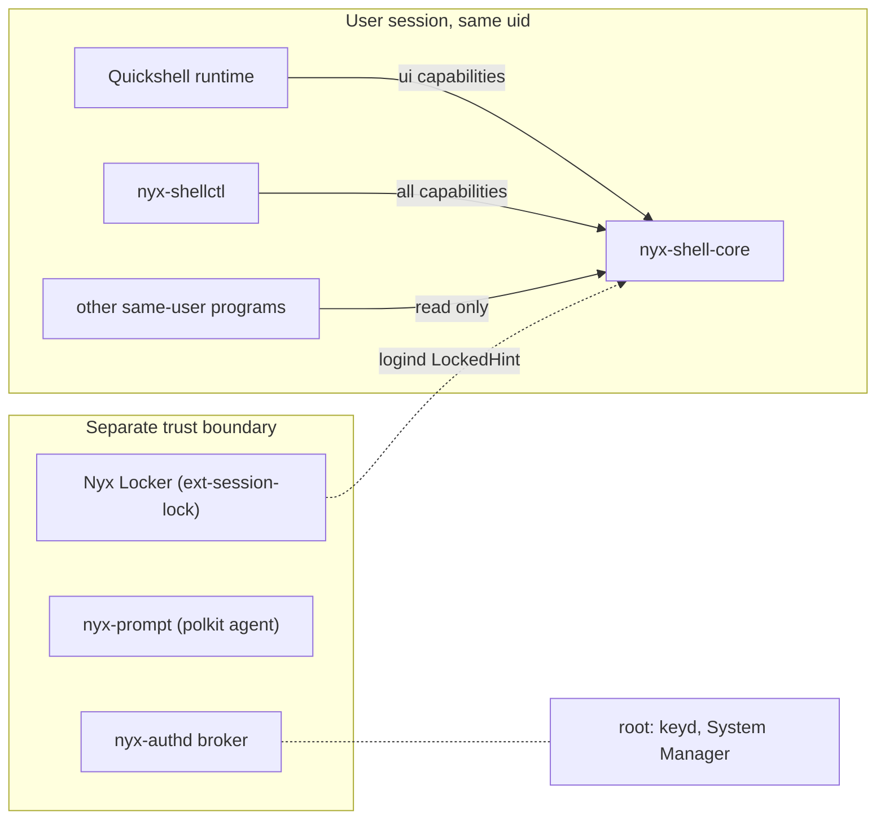

# Nyx Shell Core: security boundaries

## What Shell Core is trusted with

Compositor state (window titles and app ids included), overlay visibility, focus
changes on the user's own windows, and the user's `shell` settings. Nothing else.

It is **not** trusted with, and has no operation for:

- unlocking the session, authenticating, approving, or reading secrets;
- running a command a client names;
- privileged (root) actions of any kind;
- notification contents, clipboard contents, AI conversations.

## Trust boundaries

- **Other users:** refused at accept by `SO_PEERCRED`. The socket is 0600 in a 0700
  folder in `$XDG_RUNTIME_DIR` as a second layer; a local socket isn't assumed safe on
  its own.
- **Same user:** a same-user process can already drive Hyprland (`hyprctl`) and read
  every file of the session, so the same-user line is the real boundary. Capabilities
  inside it limit what a confused or compromised ordinary client can do through Shell
  Core, and keep the surface small.
- **Lock screen and authentication:** outside Shell Core entirely. Nyx Locker holds the
  session through ext-session-lock in its own process, restarted by systemd, with a
  hyprlock fallback; Hyprland keeps the session locked if it dies. A crashed or missing
  Shell Core or Quickshell runtime changes nothing about locking. Shell Core only reads
  logind's `LockedHint` and, while it is set, hides every overlay and refuses to show
  any, and never restores focus. Authentication secrets never pass through it.

## Capabilities

| Capability | Allows |
| --- | --- |
| `desktop.read` | Snapshots, status, subscriptions to every topic |
| `desktop.act` | `RequestWorkspaceAction`, `RequestWindowAction` |
| `overlay.manage` | Register, unregister, show, hide, toggle overlays |
| `component.register` | Register components and report their health |
| `action.invoke` | `InvokeAction` |
| `config.write` | `UpdateShellConfig`, `ResetShellConfig` |

How a client is classified (`peer.rs`), from `/proc/PID/exe` at connect time:

| Client | How recognized | Capabilities |
| --- | --- | --- |
| `nyx-shellctl` | `nyx_peer::program`: in Shell Core's own folder or a folder listed in root-owned `/etc/nyx/trusted-bin` | all |
| `nyx-settings` | same | `desktop.read`, `config.write` |
| Quickshell runtime | executable named `quickshell` in a trusted folder, or a path in `ipc.ui_runtimes` (default `/usr/bin/quickshell`; a change applies to new connections) | `desktop.read`, `desktop.act`, `overlay.manage`, `component.register`, `action.invoke` |
| anything else of the same user | | `desktop.read` |

Quickshell runs any QML it is given, so recognizing it by executable grants those
capabilities to any same-user program willing to start it. That is accepted because
none of them reach beyond what `hyprctl` already offers, and none is sensitive.

## Input handling

- Every request is parsed into typed structures; unknown operations and malformed bodies
  are errors, never guesses.
- Lines are capped at 1 MiB, action arguments at 4 KiB, ids at 64 characters of
  `[a-z0-9._:-]`.
- Window addresses must exist in the current state and are hex; monitor names must
  exist; workspace strings are restricted to ids and `name:`/`special:` names of
  `[A-Za-z0-9_-]`. Nothing from a client is placed into a Hyprland command without
  passing these checks, so no client text can reach Lua or a dispatcher unescaped.
- Window titles, app ids and service payloads are untrusted: titles are cut to 512
  characters with control characters removed; QML renders them as plain text.
- Each client has a bounded event queue; a slow client gets `Resync`, not unbounded
  memory.

## Logging

`tracing` with structured fields. Window titles are never logged. Notification bodies,
clipboard contents and conversations never reach Shell Core. `NYX_SHELL_LOG_SENSITIVE=1`
allows titles in debug logs for local troubleshooting only.

## Known limits

- Peer identity is read at connect time; a same-user process could in principle race a
  PID. Same-user processes are not the boundary (above).
- **The lock is seen through logind's `LockedHint`**, which Nyx Locker sets once the
  session lock holds and clears on unlock (nyx-greeter `ab65ecd`; before it, nothing set
  it and Shell Core's lock rules didn't engage). Hyprland has no lock event. If the
  locker dies, NyxOS's `nyx-lock` falls back to hyprlock and clears the hint once
  hyprlock has unlocked (nyxos `e0690d3`). Even without the hint nothing gets past the
  lock: nothing is drawn or typed above an ext-session-lock surface, and Shell Core has
  no unlock operation. On Omarchy the shell's own lock doesn't set the hint.
